Hi  My name is Warda
==============================================================================================================================

Web Developer
-------------


<div align="center">

<br/>


<br/><br/>


</div>

---

## 👋 About Me

```js
const warda = {
  name:      "Warda Developer",
  from:      "Karachi, Pakistan 🇵🇰",
  role:      "Full-Stack Web Developer",
  loves:     ["Animated UIs", "3D on the web", "Real-time apps", "E-commerce"],
  stack:     ["HTML", "CSS", "JavaScript", "Tailwind CSS", "React", "Firebase"],
  lookingAt: "Three.js and smoother, faster interfaces",
  funFact:   "I judge websites by their hover animations ✨",
};
```

<div align="center">

</div>

---

## 🛠️ Tech I Use

<div align="center">


<br/>


</div>

---

## 📊 GitHub Stats

<div align="center">


</div>

---

## 🐍 Contribution Snake

<div align="center">
<picture>
  <source media="(prefers-color-scheme: dark)" srcset="https://raw.githubusercontent.com/YOUR_USERNAME/YOUR_USERNAME/output/github-snake-dark.svg"/>
  
</picture>
</div>

> The snake is generated by a GitHub Action. Add `snake.yml` as `.github/workflows/snake.yml`, then run it once from the **Actions** tab.

---

## 🤝 Let's Connect

<div align="center">

[](https://www.linkedin.com/in/warda-web-developer-1w68p195/)
[](mailto:webandappdeveloperwarda17@gmail.com)
[](https://www.pinterest.com/warda_developer/_profile/)
[](https://www.youtube.com/channel/UCjiuI7Kaoca3AtGWMKo10EQ)
[](https://www.facebook.com/profile.php?id=61596152099258)
[](https://alumni.saylaniit.com/wardadeveloper)



</div>


<p align="left">
<a href="https://developer.mozilla.org/en-US/docs/Web/JavaScript" target="_blank" rel="noreferrer"></a><a href="https://git-scm.com/" target="_blank" rel="noreferrer"></a><a href="https://www.typescriptlang.org/" target="_blank" rel="noreferrer"></a><a href="https://code.visualstudio.com/" target="_blank" rel="noreferrer"></a><a href="https://developer.mozilla.org/en-US/docs/Glossary/HTML5" target="_blank" rel="noreferrer"></a><a href="https://reactjs.org/" target="_blank" rel="noreferrer"></a><a href="https://www.w3.org/TR/CSS/#css" target="_blank" rel="noreferrer"></a><a href="https://tailwindcss.com/" target="_blank" rel="noreferrer"></a><a href="https://sass-lang.com/" target="_blank" rel="noreferrer"></a><a href="https://nextjs.org/docs" target="_blank" rel="noreferrer"></a><a href="https://expressjs.com/" target="_blank" rel="noreferrer"></a><a href="https://www.mongodb.com/" target="_blank" rel="noreferrer"></a><a href="https://nodejs.org/en/" target="_blank" rel="noreferrer"></a><a href="https://firebase.google.com/" target="_blank" rel="noreferrer"></a><a href="https://docs.nestjs.com/" target="_blank" rel="noreferrer"></a><a href="https://www.figma.com/" target="_blank" rel="noreferrer"></a><a href="https://www.linux.org" target="_blank" rel="noreferrer"></a>
</p>


